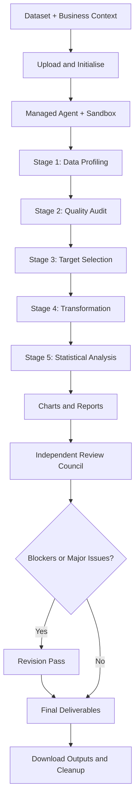

# 🤖 Expert Data Analyst
### An AI-Powered, Multi-Agent Framework for Automated Exploratory Data Analysis

An intelligent, dataset-agnostic data analysis framework that automates the end-to-end exploratory data analysis (EDA) process using Anthropic's Managed Agents API. It profiles datasets, audits data quality, identifies analytical targets, performs reproducible data transformations, generates statistical analyses and visualisations, and produces stakeholder-ready reports.

Unlike conventional EDA notebooks that rely on a single prompt or a fixed dataset, **Expert Data Analyst** follows a structured five-stage analytical workflow and subjects its outputs to an independent three-agent review council before publishing a revised final report.

The goal is not merely to automate analysis, but to make it **reproducible, transparent, auditable, and decision-oriented.**

---

## 📌 Table of Contents

- [Project Overview](#-project-overview)
- [Key Features](#-key-features)
- [System Architecture](#-system-architecture)
- [The Five-Stage EDA Workflow](#-the-five-stage-eda-workflow)
- [Multi-Agent Review Council](#-multi-agent-review-council)
- [Generated Deliverables](#-generated-deliverables)
- [Technology Stack](#-technology-stack)
- [Getting Started](#-getting-started)
- [Configuration](#️-configuration)
- [Project Structure](#-project-structure)
- [Data Governance and Reliability](#-data-governance-and-reliability)
- [Limitations](#️-limitations)
- [Future Improvements](#-future-improvements)
- [Author](#-author)

---

## 🔍 Project Overview

Exploratory data analysis is a foundational step in the data analytics lifecycle. However, conducting it consistently requires considerable effort across data profiling, quality assessment, transformation, statistical analysis, visualisation, documentation, and validation.

This project addresses these challenges through a managed AI-agent workflow that separates analysis into distinct stages, preserves context across the workflow, and introduces independent quality checks before final publication.

### The problem

Traditional exploratory analysis workflows can suffer from:

- Repetitive manual profiling and data cleaning.
- Dataset-specific scripts that are difficult to reuse.
- Inconsistent treatment of missing values, duplicates, and outliers.
- Statistical findings without sufficient evidence or context.
- Reports and visualisations that require substantial manual preparation.
- Limited independent review of analytical assumptions and conclusions.

### The solution

Expert Data Analyst combines AI-agent orchestration with executable Python analysis, structured outputs, and independent reviewer agents.

The framework accepts a tabular dataset and business context, performs a staged analysis, generates multiple deliverables, and uses reviewer feedback to guide a revision pass.

### What makes this project different?

| Capability | Conventional EDA notebook | Expert Data Analyst |
|---|---|---|
| Dataset handling | Often dataset-specific | Configurable, dataset-agnostic workflow |
| Analysis execution | Manually orchestrated | Five staged agent turns |
| Data quality | Analyst-dependent checks | Structured quality audit and scorecard |
| Transformations | Often embedded in code | Explicit transformation decision log |
| Visualisations | Manually selected and produced | Automated chart generation |
| Reporting | Frequently assembled manually | Markdown, standalone HTML, and Excel |
| Quality assurance | Often self-review | Three independent specialist reviewers |
| Revision | Manual corrections | Feedback-driven revision loop |
| Reproducibility | Varies by notebook | Re-runnable scripts for analytical stages |

---

## ✨ Key Features

### 1. Dataset-agnostic analysis

Configure the input file and business context without rewriting the analytical workflow for each dataset.

The notebook is designed for CSV, Excel, JSON, Parquet, and TSV inputs, subject to the relevant file-reading dependencies and the format-handling implementation.

### 2. Automated data profiling

Generate a structured overview of the dataset, including:

- Row and column counts.
- Column names, data types, and non-null counts.
- Missing-value counts and percentages.
- Numerical and categorical descriptive statistics.
- Column cardinality and potential identifiers.
- Constant and near-constant columns.
- Memory footprint and sample records.

### 3. Data quality assessment

Audit potential data issues before applying transformations:

- Fully duplicated records and candidate business-key duplicates.
- Missing values and missingness patterns.
- Inconsistent column naming.
- Incorrect data types and invalid values.
- Placeholder values and outliers.
- Redundant or potentially unnecessary columns.

A data quality scorecard evaluates completeness, uniqueness, validity, and consistency.

### 4. Analytical target selection

Use the business context and dataset characteristics to nominate a primary outcome variable, or validate a user-specified target.

The framework also screens secondary variables, identifies potential leakage, and flags identifier or administrative columns that should not be used as predictive features.

### 5. Reproducible data transformation

Apply justified transformations while documenting decisions and their effects.

The transformation stage addresses type conversion, category standardisation, missing values, duplicate removal, feature engineering, and column removal.

A safeguard requires approval when a single transformation would remove more than 5% of the rows.

### 6. Automated statistical analysis and visualisation

Perform univariate, bivariate, and multivariate analysis using appropriate statistical techniques and chart types.

The workflow also screens for multicollinearity and, where appropriate, produces PCA visualisations and a baseline model for feature-relevance screening.

### 7. Multi-agent quality assurance

Use three independent reviewer roles to challenge the analysis from different perspectives:

- Data integrity.
- Statistical validity.
- Communication and visualisation quality.

Findings are classified by severity, and blockers and major issues feed into a revision pass.

### 8. Stakeholder-ready reporting

Generate a collection of deliverables that support different needs, from technical reproducibility to executive consumption.

These include Python scripts, JSON artifacts, PNG charts, a Markdown report, a self-contained HTML report, and a formatted Excel workbook.

---

## 🏗️ System Architecture

The framework follows a staged pipeline, with a persistent analysis session maintaining context between analytical stages.



### Architectural components

| Component | Responsibility |
|---|---|
| Anthropic SDK | API access and agent/session orchestration |
| Managed Agents | Execute the staged analysis workflow |
| Cloud sandbox | Provide an isolated execution environment |
| Python scripts | Make analytical operations reproducible |
| JSON artifacts | Store structured analytical results and decisions |
| Reviewer sessions | Independently evaluate the generated artifacts |
| Output retrieval | Download and organise generated deliverables |

The analyst operates in a persistent session so subsequent stages can use previous findings and files. Reviewer sessions use separate specialist instructions and inspect the resulting artifacts rather than relying on the analyst's original reasoning.

---

## 🔬 The Five-Stage EDA Workflow

### Stage 1 — Data Profiling

**Objective:** Establish what the dataset contains and how it is structured.

The agent loads the dataset, inspects its schema, summarises its columns, and flags potential type mismatches and unusual cardinality.

**Key outputs:**
- `01_profile.json`
- `eda_01_profile.py`

### Stage 2 — Data Quality Audit

**Objective:** Identify potential data issues before modifying the dataset.

The agent evaluates duplicates, missingness, invalid values, inconsistent naming, outliers, and candidate columns for removal.

A data quality scorecard is generated, with component scores and their arithmetic.

**Key outputs:**
- `02_data_quality.json`
- `eda_02_quality.py`

### Stage 3 — Target and Variable Selection

**Objective:** Establish the primary analytical question and identify relevant variables.

The agent nominates a target where appropriate, classifies the analytical problem, ranks secondary variables using statistical screening, and flags potential leakage.

Depending on variable types, the screening can include:

- Pearson and Spearman correlations.
- Group means and eta-squared effect sizes.
- Chi-square tests and Cramér's V.

These are exploratory, unadjusted screens rather than proof of causation or definitive evidence of predictive performance.

**Key outputs:**
- `03_target_selection.json`
- `eda_03_target.py`

### Stage 4 — Data Transformation

**Objective:** Produce a cleaned dataset through documented, reproducible transformations.

The agent starts again from the raw input and applies justified changes, recording the actions, reasons, affected rows or cells, and reversibility.

Outliers are retained by default unless there is evidence that a value is implausible. Transformations that would remove more than 5% of rows individually require approval rather than proceeding automatically.

**Key outputs:**
- `cleaned_dataset.csv`
- `04_transformations.json`
- `eda_04_transform.py`

### Stage 5 — Statistical Analysis and Reporting

**Objective:** Discover patterns, quantify relationships, and communicate actionable findings.

The agent performs:

- **Univariate analysis:** distributions, descriptive statistics, categorical frequencies, and temporal patterns.
- **Bivariate analysis:** relationships between the primary variable and relevant secondary variables.
- **Multivariate analysis:** correlation matrices, multicollinearity screening, grouped comparisons, and PCA where applicable.
- **Baseline modelling:** a simple model for feature-relevance screening when a suitable target exists.
- **Insight ranking:** prioritisation by decision value rather than statistical significance alone.

**Key outputs:**
- `05_insights.json`
- `eda_05_analysis.py`
- `eda_report.md`
- `eda_report.html`
- `expert_eda_report.xlsx`
- PNG visualisations

---

## 🛡️ Multi-Agent Review Council

A key design feature is the separation of analysis from review.

Instead of relying solely on the analyst agent to validate its own work, the notebook creates independent reviewer sessions with specialist instructions.

| Reviewer | Primary responsibility |
|---|---|
| Data Quality Auditor | Checks missingness handling, duplicate treatment, type conversions, and transformation traceability |
| Statistical Methodologist | Reviews statistical methods, sample sizes, confounding, multiple comparisons, and unsupported causal claims |
| Communication Critic | Assesses chart quality, insight relevance, report clarity, and limitations |

Each reviewer produces structured findings with severity, evidence, recommended fixes, confidence, and a verdict.

### Revision mechanism

The framework prioritises findings classified as:

- **Blocker:** the conclusion is unsafe to publish.
- **Major:** the issue materially weakens a finding.
- **Minor:** a smaller issue or improvement.

Blockers and major findings are passed back to the original analyst session for a revision pass. The analyst must either address the issue or reject it with supporting evidence.

The revision log records the review finding, decision, rationale, and files changed.

This design creates a more auditable review process, although it does not guarantee that the reviewers will identify every analytical error.

---

## 📦 Generated Deliverables

The framework is designed to produce a complete analytical package rather than a single notebook output.

| Artifact | Purpose |
|---|---|
| `01_profile.json` | Structured dataset profile |
| `02_data_quality.json` | Quality findings and scorecard |
| `03_target_selection.json` | Target rationale and variable screening |
| `04_transformations.json` | Transformation decision log |
| `05_insights.json` | Ranked, evidence-based insights |
| `06_revision_log.md` | Reviewer decisions and revision history |
| `cleaned_dataset.csv` | Transformed dataset |
| `eda_report.md` | Human-readable analytical report |
| `eda_report.html` | Standalone report with embedded chart images |
| `expert_eda_report.xlsx` | Workbook with six analytical sheets |
| `eda_01_profile.py` to `eda_05_analysis.py` | Re-runnable analytical scripts |
| `05_*.png` | Statistical charts and visualisations |

The Excel workbook is designed to include the following sheets:

1. Overview
2. Data Quality
3. Column Profile
4. Target Analysis
5. Transformation Log
6. Insights

Outputs are organised into an `outputs/` directory, with separate locations for analyst outputs, reviewer artifacts, and final revised deliverables.

**Note:** Exact artifact availability depends on successful completion of each stage. The notebook checks for missing outputs and reports execution failures rather than guaranteeing that every file will exist after every run.

---

## 🧰 Technology Stack

| Technology | Role |
|---|---|
| Python | Analysis orchestration and reproducible scripts |
| Anthropic SDK | Managed Agents API integration |
| `python-dotenv` | Environment-variable and API-key configuration |
| Pandas | Tabular data manipulation within the analysis environment |
| Matplotlib | Statistical visualisation |
| Seaborn | Optional supplementary visualisation |
| JSON | Structured analysis results and audit artifacts |
| Markdown and HTML | Analytical reporting |
| Excel / XLSX skill | Structured workbook generation |
| Jupyter Notebook | Interactive execution and inspection |
| Mermaid | Architecture and workflow documentation |

Pandas, Matplotlib, and related analysis libraries are expected to run inside the managed sandbox. Additional libraries may be needed depending on the dataset format and the analysis requested.

---

## 🚀 Getting Started

### Prerequisites

Before running the project, ensure you have:

- Python and Jupyter Notebook or JupyterLab.
- An Anthropic API account and a valid API key.
- Access to the Managed Agents beta API and its required capabilities.
- A supported tabular dataset.
- Sufficient API usage allowance for the analyst, reviewer, and revision sessions.

Managed Agents availability and API requirements may depend on the account or workspace.

### 1. Clone the repository

```bash
git clone <your-repository-url>
cd <your-repository-directory>
```

Replace the placeholders with your actual GitHub repository URL and directory name.

### 2. Create a virtual environment

```bash
python -m venv .venv
```

Activate it on Windows:

```powershell
.venv\Scripts\Activate.ps1
```

On macOS or Linux:

```bash
source .venv/bin/activate
```

### 3. Install dependencies

Install the required local packages:

```bash
pip install --upgrade anthropic python-dotenv jupyter
```

The notebook also contains an installation cell for the SDK and `python-dotenv`.

### 4. Configure the API key

Create a local `.env` file in the project root:

```dotenv
ANTHROPIC_API_KEY=your_anthropic_api_key
```

Keep `.env` out of version control. Add it to `.gitignore` and never commit API credentials or sensitive datasets.

### 5. Add your dataset

Place your dataset in the project directory, or configure an appropriate path to the file.

For example:

```text
project/
├── .env
├── .gitignore
├── expert_data_analyst.ipynb
├── parental_leave.csv
└── outputs/
```

The notebook filename above is illustrative; use the actual filename in your repository.

### 6. Configure the analysis

Update the configuration cell in the notebook:

```python
from pathlib import Path

DATASET_PATH = Path("parental_leave.csv")

BUSINESS_CONTEXT = (
    "Analyse company parental leave policies to compare "
    "maternity and paternity provision across industries."
)

TARGET_HINT = None

AGENT_NAME = "Expert Data Analyst"
MODEL = "claude-sonnet-5"

REUSE_AGENT = True
ARCHIVE_AGENT_ON_CLEANUP = False

RUN_COUNCIL = True
RUN_REVISION = True

TURN_TIMEOUT_S = 2400
OUTPUT_ROOT = Path("outputs")
```

The dataset and business context are examples. Replace them with values appropriate to your own analysis.

### 7. Run the notebook

Launch Jupyter:

```bash
jupyter notebook
```

Open the notebook and execute the setup and configuration cells, followed by the analysis pipeline.

The notebook runs the five stages in sequence, retrieves the generated artifacts, invokes the reviewer council, and performs a revision pass when required.

### 8. Inspect the results

Review the generated reports, charts, quality scorecard, transformation log, ranked insights, and revision log.

Do not treat a completed run as automatic validation of the findings. Verify important statistics, transformation decisions, and conclusions before using them for business decisions.

---

## ⚙️ Configuration

The primary configuration variables allow the workflow to be adapted without changing its underlying design.

| Parameter | Description |
|---|---|
| `DATASET_PATH` | Input dataset path |
| `BUSINESS_CONTEXT` | Business problem and intended audience |
| `TARGET_HINT` | Optional primary target variable |
| `AGENT_NAME` | Name used to identify the reusable analyst agent |
| `MODEL` | Configured Anthropic model identifier |
| `REUSE_AGENT` | Whether to reuse an existing matching agent |
| `ARCHIVE_AGENT_ON_CLEANUP` | Whether to permanently archive created agents |
| `RUN_COUNCIL` | Enables or disables independent reviewer sessions |
| `RUN_REVISION` | Enables or disables the feedback-driven revision pass |
| `TURN_TIMEOUT_S` | Per-turn timeout guard |
| `OUTPUT_ROOT` | Local directory for downloaded artifacts |

### Recommended configuration practices

- Provide a specific business context rather than a generic instruction to analyse the data.
- Supply `TARGET_HINT` when the intended outcome is known, but allow the agent to challenge an unsuitable target.
- Keep the review council enabled for work intended for stakeholders.
- Avoid archiving reusable agents unless permanent archival is intentional.
- Inspect stage outputs before rerunning later stages when the analysis takes an unexpected direction.

---

## 📁 Project Structure

The following illustrates the intended repository and generated-output organisation. Actual filenames may differ depending on how the notebook is saved and which stages complete successfully.

```text
expert-data-analyst/
│
├── expert_data_analyst.ipynb
├── .env                         # Local secret; never commit
├── .gitignore
├── README.md
│
├── data/
│   └── sample_dataset.csv
│
└── outputs/
    ├── analyst/
    │   ├── eda_report.md
    │   ├── eda_report.html
    │   ├── expert_eda_report.xlsx
    │   ├── 01_profile.json
    │   ├── 02_data_quality.json
    │   ├── 03_target_selection.json
    │   ├── 04_transformations.json
    │   ├── 05_insights.json
    │   ├── cleaned_dataset.csv
    │   └── 05_*.png
    │
    ├── review/
    │   ├── data_quality_auditor/
    │   ├── statistical_methodologist/
    │   └── communication_critic/
    │
    └── final/
        ├── eda_report.md
        ├── eda_report.html
        ├── expert_eda_report.xlsx
        └── 06_revision_log.md
```

This is a conceptual structure, not a guarantee that every file or directory is created in every run. The notebook uses flat output paths inside the managed session and downloads artifacts into local output directories.

---

## 🔐 Data Governance and Reliability

The framework incorporates several safeguards intended to improve the trustworthiness of automated analysis.

### Reproducibility

Analytical stages produce Python scripts that can be inspected and rerun, rather than relying exclusively on undocumented, one-off operations.

### Transformation traceability

The transformation log is designed to record changes, reasons, affected records or cells, and reversibility.

### Statistical discipline

The analyst instructions require sample sizes alongside statistics, spread alongside means, caution around small samples, and clear separation between association and causation.

### Explicit uncertainty

Each analytical stage is instructed to identify unresolved questions and explain what additional data or domain knowledge would help resolve them.

### Independent review

The review council provides a second layer of scrutiny, while the revision log documents how significant findings were handled.

### Resource management

The notebook tracks created sessions, environments, files, and agents. Cleanup removes temporary resources while retaining the reusable analyst agent by default.

### Security considerations

The input dataset is mounted read-only in the managed environment, and the sandbox is configured with limited networking by default.

However, read-only mounting and restricted networking do not by themselves guarantee confidentiality. Users should review Anthropic's applicable data handling, retention, and access policies before uploading sensitive, personal, financial, or regulated information.

---

## ⚠️ Limitations

This project is an analytical assistant, not a replacement for statistical judgement or domain expertise.

- **AI-generated analysis requires verification.** The agent and reviewer council may both miss errors or make incorrect interpretations.
- **Target selection is context-dependent.** A dataset may not contain a suitable predictive outcome, even when a target is requested.
- **Statistical screening is not causal inference.** Correlations, effect sizes, and baseline feature rankings do not establish causation.
- **Data quality scores depend on their scoring methodology.** A score out of 100 should not be treated as a universal measure of dataset fitness.
- **Transformations can introduce bias.** Missing-value treatment, category merging, outlier handling, and feature engineering require domain-aware review.
- **Large datasets may be constrained by execution resources.** Runtime, memory, and processing requirements depend on the input and analysis.
- **Model availability may vary.** The configured model identifier and Managed Agents beta capabilities must be supported by the user's workspace.
- **Review adds cost and runtime.** Running three reviewer sessions and a revision pass consumes additional API resources.
- **Not every deliverable is guaranteed.** API failures, unsupported file formats, missing dependencies, or interrupted stages can prevent some artifacts from being generated.

The framework therefore emphasises traceability and review rather than claiming fully autonomous, error-free analysis.

---

## 🔭 Future Improvements

Potential extensions include:

- **Domain-specific reviewers:** Add specialist reviewers for banking, credit risk, fraud analytics, climate, and sustainability.
- **Persistent audit history:** Store transformation and revision logs against dataset versions for easier comparison and governance.
- **Batch processing:** Run the workflow across multiple datasets and generate consolidated reporting.
- **Automated evaluation:** Use explicit outcome rubrics to evaluate report completeness and analytical quality.
- **Native multi-agent coordination:** Explore supported coordinator and delegation capabilities as they become available.
- **Testing and continuous integration:** Add unit tests for transformation utilities, schema validation, output contracts, and failure handling.
- **Observability:** Track API usage, execution time, failures, reviewer findings, and revision outcomes.
- **Deployment:** Package the workflow as a scheduled service or a user-facing analytical application.

---

## 👨‍💻 Author

**Vin**

Data Analyst | Data Science | Analytics Engineering

Interested in building reliable, scalable data solutions that translate complex datasets into actionable business insights.

---

## 📄 License

No license has been specified in the supplied notebook. Add an appropriate open-source or proprietary license before distributing the project publicly.

---

*Expert Data Analyst — from raw data to reviewed, reproducible, decision-ready insights.*
